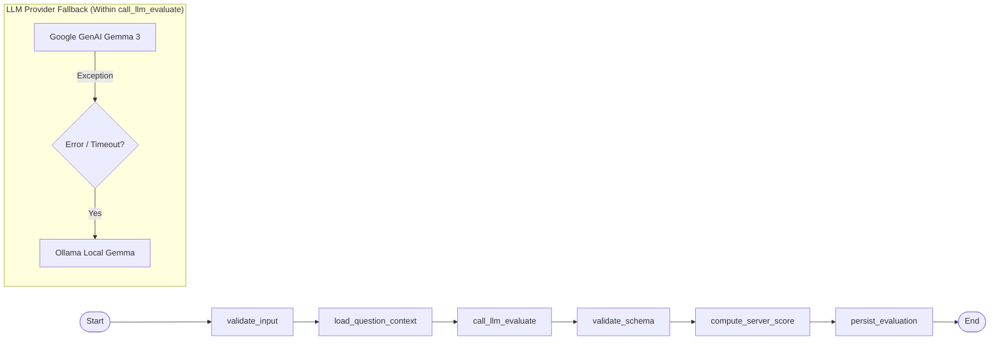
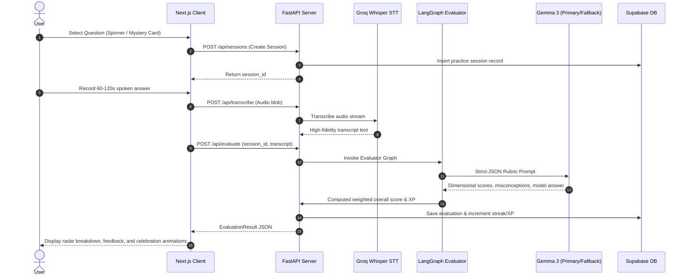

# SpeakQuest AI (Flicker) 🎙️⚡

> **Gamified Verbal Concept Mastery & Technical Interview Practice Platform**  
> Explain complex engineering, architecture, and scientific concepts aloud. Receive real-time speech transcription, structured multi-dimensional evaluation, misconception detection, and exemplar answers powered by LangGraph, Gemma 3, and Groq Whisper.

---

## 📑 Table of Contents
- [🎯 Core Use Cases](#-core-use-cases)
- [🏛️ System Design & Architecture](#️-system-design--architecture)
  - [High-Level System Architecture](#high-level-system-architecture)
  - [LangGraph Evaluation Pipeline](#langgraph-evaluation-pipeline)
  - [User Session & Assessment Sequence](#user-session--assessment-sequence)
- [🤖 Models & AI Provider Use Cases](#-models--ai-provider-use-cases)
  - [Model Specification Table](#model-specification-table)
  - [Detailed Model Roles & Rationale](#detailed-model-roles--rationale)
  - [Evaluation Rubric & Scoring Weights](#evaluation-rubric--scoring-weights)
- [📂 Project Structure](#-project-structure)
- [🔌 API Endpoints](#-api-endpoints)
- [🚀 Quick Start Guide](#-quick-start-guide)
  - [1. Prerequisites](#1-prerequisites)
  - [2. Environment Configuration](#2-environment-configuration)
  - [3. Database Setup](#3-database-setup)
  - [4. Backend Service](#4-backend-service)
  - [5. Frontend Application](#5-frontend-application)
  - [6. Local Ollama Fallback (Optional)](#6-local-ollama-fallback-optional)
- [🧪 Testing & Quality Checks](#-testing--quality-checks)

---

## 🎯 Core Use Cases

SpeakQuest AI transforms passive technical learning into active, vocalized mastery through targeted use cases:

1. **Verbal Technical Interview Simulation**  
   Software engineers and technical job-seekers practice articulating complex topics (e.g., distributed consensus, database indexing, caching strategies) under timed conditions (60–120s), mimicking real interview environments.
2. **The Feynman Technique & Active Recall**  
   Forces learners to explain challenging concepts simply and coherently without reading or looking at notes, testing true comprehension versus illusion of competence.
3. **Automated Multi-Dimensional Feedback**  
   Replaces subjective self-grading with automated scoring across 6 key evaluation dimensions: conceptual accuracy, clarity, depth of explanation, technical precision, structure, and question relevance.
4. **Actionable Misconception Diagnosis & Exemplar Formulation**  
   Pinpoints specific misconceptions, notes missing keywords/principles, and generates a polished, natural exemplar answer to show how a senior practitioner would phrase the explanation.
5. **Gamification & Habit Building**  
   Drives consistent daily speaking practice through mystery card draws, interactive topic spinning wheels, experience points (XP), streak multipliers, and leveled progression.

---

## 🏛️ System Design & Architecture

### High-Level System Architecture

```mermaid
flowchart TD
    subgraph Client["Frontend Layer (Next.js 14 App Router)"]
        UI["Tailwind CSS + Glassmorphism UI"]
        Rec["MediaRecorder Web Audio API"]
        Pages["Pages: /dashboard, /game, /profile, /login, /signup"]
        Gamification["Interactive Spinner & Mystery Cards"]
    end

    subgraph AuthDB["Identity & Persistence (Supabase)"]
        SupaAuth["Supabase Authentication (JWT)"]
        SupaDB[("PostgreSQL Database (RLS Enabled)")]
        Tables["Tables: profiles, questions, sessions, evaluations, progress"]
    end

    subgraph Backend["Backend API Layer (FastAPI + LangChain)"]
        API["FastAPI REST Routers (/api/*)"]
        AuthMid["JWT Auth Middleware"]
        RateLimiter["In-Memory Rate Limiting"]
        Config["AppConfig (model.yaml Loader)"]
    end

    subgraph AI["AI & Pipeline Execution"]
        STT["Groq Whisper API (whisper-large-v3-turbo)"]
        QAgent["LangGraph Question Agent (Topic & Question Generator)"]
        EvalAgent["LangGraph Evaluator Agent (StateGraph)"]
        
        subgraph LLMLayer["LLM Providers & Fallback Engine"]
            PrimaryLLM["Primary: Google AI Studio (gemma-3-12b-it)"]
            FallbackLLM["Fallback: Local Ollama (gemma-local:latest)"]
        end
    end

    UI -->|Record Speech (webm/mp4/wav)| Rec
    Rec -->|Upload Audio Blob| API
    Pages -->|Token Auth & Profile Sync| SupaAuth
    API -->|Validate Token| SupaAuth
    API -->|Audio Stream| STT
    STT -->|Transcript & Timestamps| EvalAgent
    EvalAgent -->|Execute Graph| PrimaryLLM
    PrimaryLLM -.->|Connection / RateLimit Fail| FallbackLLM
    EvalAgent -->|Scorecard & XP| API
    QAgent -->|Fetch / Generate Questions| PrimaryLLM
    API -->|Persist Result| SupaDB
    API -->|Return Feedback & Progress| Client
```

---

### LangGraph Evaluation Pipeline

The evaluation workflow uses a directed `StateGraph` in LangGraph to ensure deterministic, fault-tolerant analysis of spoken answers:



---

### User Session & Assessment Sequence



---

## 🤖 Models & AI Provider Use Cases

### Model Specification Table

| Capability | Provider | Model ID | Primary Use Case | Failover / Backup |
|---|---|---|---|---|
| **Speech-to-Text (STT)** | Groq Cloud | `whisper-large-v3-turbo` | Ultra-fast speech transcription from recorded audio (webm, wav, mp4, mp3, m4a) with timestamps. | `whisper-large-v3` |
| **Primary Evaluation LLM** | Google AI Studio | `gemma-3-12b-it` (or `27b`) | Multi-dimensional rubric scoring, structured feedback generation, technical misconception diagnosis, and model answers. | Automatic failover to local Ollama |
| **Fallback Evaluation LLM** | Ollama (Local) | `gemma-local:latest` (`gemma3:12b`) | High-availability zero-cloud fallback when rate limits, connection errors, or timeouts occur. | N/A |
| **Question & Topic Generator** | Google AI Studio / Ollama | `gemma-3-12b-it` | Generates 10 dynamic, customized questions and focus topics adapted to user domain and experience level. | Ollama Local Gemma |

---

### Detailed Model Roles & Rationale

1. **Groq Whisper (`whisper-large-v3-turbo`)**
   - **Why Groq Whisper?** Traditional speech transcription causes 4–10 second latency bottlenecks. Groq’s LPU hardware delivers sub-second transcription for up to 2-minute audio recordings.
   - **Use Case:** Transcribes the user's spoken voice accurately, properly preserving technical jargon, programming keywords, and spoken grammar without truncation.

2. **Google Gemma 3 (`gemma-3-12b-it` / `gemma-3-27b-it`)**
   - **Why Gemma 3?** Strong open-weights reasoning model with state-of-the-art instruction-following capabilities. Highly reliable for strict JSON output compliance.
   - **Use Case:**
     - Evaluates spoken transcripts against reference technical concepts.
     - Detects subtle misconceptions vs. missing concepts.
     - Synthesizes senior-level exemplar explanations.

3. **Local Ollama Fallback (`gemma-local:latest`)**
   - **Why Local Fallback?** Guarantees zero downtime. If internet drops or Google AI Studio quotas (`429 RateLimitError`, `503 ServiceUnavailable`, `TimeoutError`) are hit, the application automatically retries and processes the evaluation locally on port 11434.

---

### Evaluation Rubric & Scoring Weights

Each answer is scored on a normalized scale (0–5) per dimension, which is then computed on the server into an overall score out of 100:

| Dimension | Weight | Description |
|---|---|---|
| **Conceptual Accuracy** | **30%** | Factual correctness, absence of false statements, foundational understanding. |
| **Concept Clarity** | **20%** | Plain-language understandability, avoidance of empty jargon, lucid analogies. |
| **Depth of Understanding** | **20%** | Explanation of underlying mechanisms, trade-offs, internal behaviors, why/how. |
| **Technical Precision** | **15%** | Correct terminology, accurate system boundaries, and precise technical terms. |
| **Structure & Reasoning** | **10%** | Coherent progression, cause-and-effect flow, well-structured presentation. |
| **Relevance** | **5%** | Direct focus on the prompt without unnecessary tangents. |

---

## 📂 Project Structure

```
speakquest/
├── .env.example                     # Reference environment variables template
├── .gitignore                       # Ignored files (.env, .venv, build, __pycache__)
├── model.yaml                       # Model registry, rubric weights, and provider parameters
├── pyproject.toml                   # Python dependencies and project settings (uv)
├── README.md                        # Documentation and architecture guide
├── uv.lock                          # Locked dependency tree for deterministic Python builds
│
├── backend/                         # FastAPI Application Layer
│   ├── main.py                      # Application entry point, CORS, and router registration
│   ├── config.py                    # Settings loader from environment and model.yaml
│   ├── agents/                      # LangGraph AI Agents
│   │   ├── evaluator_agent.py       # LangGraph evaluation pipeline and rubric prompt
│   │   └── question_agent.py        # LangGraph question generation workflow
│   ├── db/                          # Database Client & Migrations
│   │   ├── migrations/              # SQL schema definitions (001_initial.sql)
│   │   └── supabase_client.py       # Supabase service role client wrapper
│   ├── middleware/                  # HTTP Middleware
│   │   ├── auth.py                  # Supabase JWT token verification
│   │   └── rate_limit.py            # Route-level rate limiting protection
│   ├── providers/                   # External AI Provider Integrations
│   │   ├── llm_provider.py          # Google GenAI + Ollama fallback engine
│   │   └── stt_provider.py          # Groq Whisper audio transcription client
│   ├── routers/                     # FastAPI Route Controllers
│   │   ├── evaluate.py              # POST /api/evaluate endpoint
│   │   ├── profile.py               # GET/PUT /api/profile endpoint
│   │   ├── progress.py              # GET /api/progress endpoint
│   │   ├── questions.py             # GET /api/questions endpoints
│   │   ├── sessions.py              # POST/GET /api/sessions endpoints
│   │   └── transcribe.py            # POST /api/transcribe endpoint
│   └── schemas/                     # Pydantic Schemas & DTOs
│       ├── evaluation.py            # EvaluationResult, DimensionScore, EvaluatorOutput
│       ├── profile.py               # Profile, Topic, ExperienceLevel
│       ├── question.py              # Question, QuestionType
│       └── session.py               # PracticeSession, SessionStatus
│
├── data/
│   └── questions_seed.json          # Pre-seeded question catalog across technical domains
│
├── frontend/                        # Next.js 14 Web Application
│   ├── package.json                 # Next.js scripts and npm dependencies
│   ├── tsconfig.json                # TypeScript compiler configuration
│   ├── tailwind.config.ts           # Styling theme tokens and animations
│   ├── src/
│   │   ├── app/                     # Next.js App Router Pages
│   │   │   ├── layout.tsx           # Global HTML layout and metadata
│   │   │   ├── globals.css          # Glassmorphism utilities and global styling
│   │   │   ├── page.tsx             # Landing / Hero page
│   │   │   ├── login/page.tsx       # Sign in page
│   │   │   ├── signup/page.tsx      # Registration page
│   │   │   ├── dashboard/page.tsx   # User analytics and session history
│   │   │   ├── profile/page.tsx     # Profile preferences and topic settings
│   │   │   └── game/page.tsx        # Live practice arena (spinner & cards)
│   │   ├── components/              # Interactive UI Components
│   │   │   ├── AuthForm.tsx         # Supabase auth form
│   │   │   ├── FeedbackDashboard.tsx# Multi-dimensional score view and breakdown
│   │   │   ├── MysteryCards.tsx     # Gamified card flip selector
│   │   │   ├── PracticeSessionView.tsx # Audio recorder, speech timer & waveform
│   │   │   ├── ProfileModal.tsx     # Profile setup and experience editor
│   │   │   ├── TopicSpinner.tsx     # Interactive randomizer wheel
│   │   │   └── UserProgressHeader.tsx # XP bar, streak counter, level badge
│   │   ├── lib/                     # Client Utilities
│   │   │   ├── api.ts               # Typed client fetch wrapper for FastAPI endpoints
│   │   │   ├── auth.ts              # Session and token management helpers
│   │   │   └── supabase.ts          # Supabase browser client
│   │   └── types/                   # TypeScript interface definitions
│   │       └── index.ts             # Shared frontend types
│
└── tests/                           # Test Suite
    ├── test_e2e_workflow.py         # End-to-end integration test
    ├── test.py                      # Provider and schema unit tests
    └── seed.py                      # Database seeding script
```

---

## 🔌 API Endpoints

| Method | Endpoint | Description | Auth Required |
|---|---|---|:---:|
| `GET` | `/health` | Service health check | No |
| `GET` | `/api/questions` | List questions filtered by topic or user profile | Optional |
| `POST` | `/api/questions/generate` | Generate fresh questions using Question Agent | Yes |
| `POST` | `/api/sessions` | Initialize a new practice session | Yes |
| `GET` | `/api/sessions` | Fetch session history for authenticated user | Yes |
| `POST` | `/api/transcribe` | Upload voice audio file (`multipart/form-data`) → Groq Whisper | Yes |
| `POST` | `/api/evaluate` | Trigger LangGraph evaluation pipeline on answer transcript | Yes |
| `GET` | `/api/profile` | Retrieve user profile, domain, and experience level | Yes |
| `PUT` | `/api/profile` | Update user profile and target topics | Yes |
| `GET` | `/api/progress` | Get user XP, current level, and daily practice streak | Yes |

---

## 🚀 Quick Start Guide

### 1. Prerequisites
- **Python 3.11+**
- **[uv](https://docs.astral.sh/uv/)** (recommended: `pip install uv` or `winget install astral-sh.uv`)
- **Node.js 20+** & **npm**
- **[Supabase](https://supabase.com)** account (Free tier)
- **[Google AI Studio API Key](https://aistudio.google.com/app/apikey)** (for Gemma 3)
- **[Groq Cloud API Key](https://console.groq.com/keys)** (for Whisper STT)

### 2. Environment Configuration
Create a `.env` file in the `speakquest/` directory based on `.env.example`:

```bash
cp .env.example .env
```

Populate the required keys in `.env`:
```env
NEXT_PUBLIC_SUPABASE_URL=https://your-project.supabase.co
NEXT_PUBLIC_SUPABASE_PUBLISHABLE_KEY=your_supabase_anon_key
SUPABASE_SERVICE_ROLE_KEY=your_supabase_service_role_key
SUPABASE_JWT_SECRET=your_supabase_jwt_secret

GEMMA_API_KEY=your_google_ai_studio_api_key
GROQ_API_KEY=your_groq_api_key

OLLAMA_BASE_URL=http://localhost:11434
BACKEND_PORT=8000
BACKEND_HOST=0.0.0.0
NEXT_PUBLIC_BACKEND_URL=http://localhost:8000
```

### 3. Database Setup
1. Open your Supabase Project dashboard → **SQL Editor**.
2. Run the migration script in [`backend/db/migrations/001_initial.sql`](backend/db/migrations/001_initial.sql).
3. Seed the question catalog:
```bash
uv run python tests/seed.py
```

### 4. Backend Service
Install dependencies and run the FastAPI server:
```bash
uv sync
uv run uvicorn backend.main:app --reload --port 8000
```
- API Docs: `http://localhost:8000/docs`
- Health check: `http://localhost:8000/health`

### 5. Frontend Application
In a separate terminal:
```bash
cd frontend
npm install
npm run dev
```
Open [http://localhost:3000](http://localhost:3000) to start practicing!

### 6. Local Ollama Fallback (Optional)
To enable offline / high-availability LLM failover:
```bash
ollama pull gemma3:12b
ollama serve
```

---

## 🧪 Testing & Quality Checks

Run the verification suite:
```bash
# Run backend unit & integration tests
uv run pytest tests/

# Execute end-to-end evaluation workflow
uv run python tests/test_e2e_workflow.py

# Lint with ruff
uv run ruff check backend/

# Type check with mypy
uv run mypy backend/
```

---

## 📄 License
MIT License. Built with passion for better technical communication.
